# Vision-Guided Block Manipulation with a 6-DOF Lite 6 Arm

An autonomous pick-and-place system for a UFACTORY Lite 6 arm with a ceiling-mounted Intel RealSense L515 RGB-D camera. It finds 25 mm and 38 mm cubes on a cluttered board, ignores distractor objects (a hand, a phone, a sponge, cylinders, arches, wedges), and then sorts, unstacks, lines up and stacks the cubes. We built the kinematics, camera calibration, perception and task planning ourselves on top of the vendor SDK.

This was the Armlab project for **ROB 550: Robotic Systems Laboratory** at the University of Michigan (Fall 2026), built by a three-person team: Hsiang-Yu (Rich) Kung, Papa Yaw Wireko Boampong and Ajinkya Pawar.

  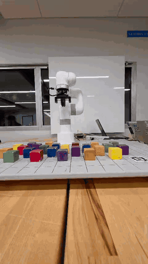
   Event 4 practice run (Oct 18, sped up). The arm builds a main tower and a side tower, then lifts the whole side tower onto the main one. On competition day this event reached <b>24 blocks</b>.

## Competition result

On competition day the system ran **all four events at the hardest level (3)**, autonomously and with distractors on the board. It scored **2,244 points and placed 3rd of 12 teams**.

| Event | Task | Score |
|---|---|---|
| 1 · Sort 'n stack | Sort small and large cubes to opposite sides, each stacked in rainbow order. Some cubes start stacked. | **300 / 300**, first try |
| 2 · Line 'em up | Arrange 6 small and 6 large cubes into two rainbow-order lines. Cubes may start stacked up to three high. | **484 / 500**, second try |
| 3 · Stack 'em high | Take apart stacks up to four high and rebuild two alternating-size rainbow towers (R r O o Y y / G g B b V v). | **500 / 500**, third try |
| 4 · To the sky | Stack large cubes as high as possible, at 40 points per cube. | **24 cubes (960)**, first try |

## Highlights

- **Verified kinematics.** Forward kinematics in both Denavit–Hartenberg and product-of-exponentials form. The two agree to 10⁻¹¹ mm, and both agree with the vendor to 2.1 mm on average.
- **Closed-form IK with an explicit branch policy.** A geometric solver uses wrist-center decoupling and a deterministic rule for elbow, base, wrist and singularity cases. It round-trips **all 500** random test poses to floating-point precision. A damped least-squares solver serves as a numerical cross-check.
- **Calibration that fixes the sensor itself.** Extrinsics come from four AprilTags (0.3 px reprojection RMS). We traced misplaced block outlines to the L515's **own depth–color misregistration (up to 10 px)** and modeled it from the edges of 235 blocks, which brought the residual to about 2 px. A per-pixel depth-bias surface is fitted at every calibration.
- **A detector that works on height, not color.** Shadows, glare and the printed grid change the color image but not the height map. Nine geometric and photometric tests reject distractors. On a 52-block test board it found **50 blocks with 0 false positives** and a **4.4 mm** mean position error.
- **Plan before moving.** Every pick and place is solved in full before the arm moves, so an unreachable target leaves the arm still. Vertical descents are checked with FK and subdivided until sideways drift is under 1.5 mm. A failed move never opens a gripper that is holding a block.

## System overview

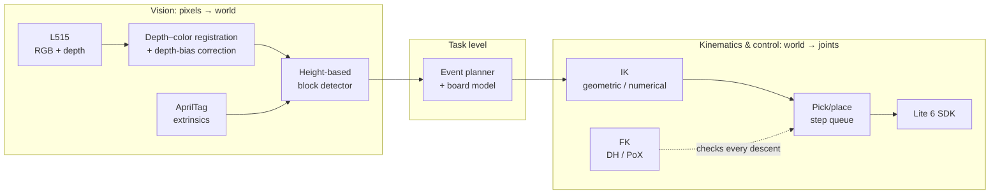

All four events share one loop: **look** (merge five detector runs from a home pose that keeps the arm out of view), **decide**, **execute one plan step per 20 Hz tick**, and **update the board model**. The system looks again only when the model can no longer be trusted. The camera sees only the top of a stack, so Events 1 and 3 first unstack onto free staging spots that are checked clear in the height map.

## Kinematics

  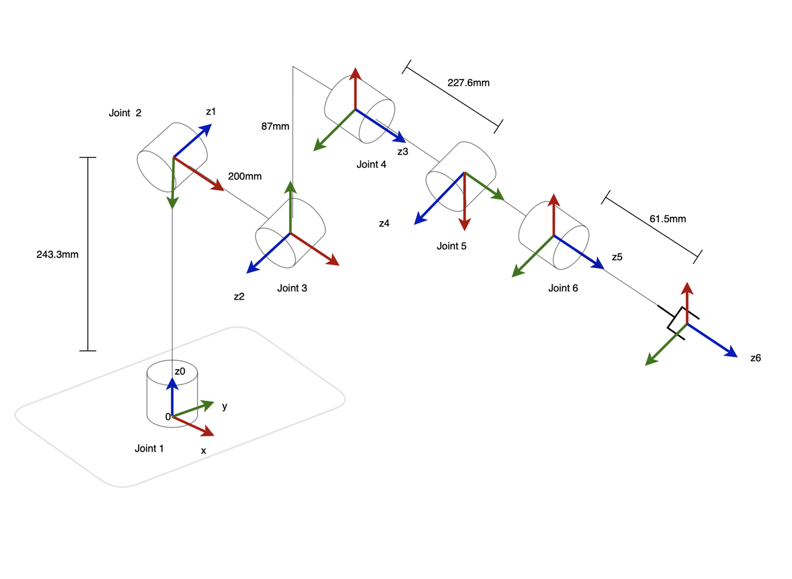
  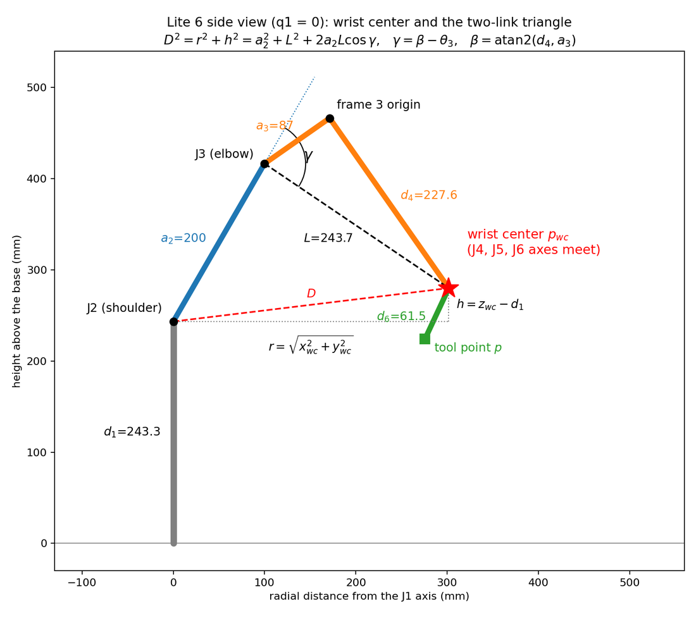
   Left: standard DH frames. Right: the wrist center (one d₆ back from the tool point) and the two-link triangle that sets q₂ and q₃.

**Forward kinematics, verified on 500 random configurations.**

| Comparison | Position error, mean / max | Orientation error, mean / max |
|---|---|---|
| DH vs. vendor | 2.10 / 4.68 mm | 0.21 / 0.33° |
| PoX vs. vendor | 2.08 / 5.02 mm | 0.21 / 0.33° |
| PoX vs. DH | < 10⁻¹¹ mm | < 10⁻⁶° |

The 2 mm residual against the vendor is smooth: it does not grow with any joint, jump, or change sign. That pattern rules out a wrong sign, offset or α in our table and points to the per-arm factory calibration the firmware applies. The firmware's own `dh_params` table turned out to be shifted by one row against standard DH, and chaining it directly misses by 400–500 mm.

**Inverse kinematics.** The spherical wrist decouples position from orientation. The geometric solver returns the solution nearest a reference configuration, so the same pose always gives the same answer, and applies these rules in order:

1. Discard any solution outside the joint limits.
2. Prefer J1 facing the target over J1 + π, so the base never swings around.
3. Prefer the default elbow branch, and use the other only when every solution on the first breaks a limit.
4. Take the wrist solution (±q₅) nearest the reference. A fixed sign made J4 and J6 jump 180° whenever a path crossed q₅ = 0.
5. At the q₅ ≈ 0 singularity, hold J4 at its reference value and let J6 take the rest.

Along vertical descents, radial sweeps and yaw sweeps, no joint changed by more than 5° between neighboring targets. The numerical solver (Levenberg–Marquardt) solved 457 of the 500 poses. All 43 failures were local minima that the geometric solver solved, which is why the numerical solver is only a fallback.

  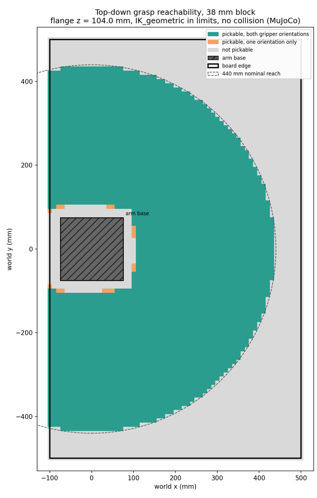
   Top-down grasp reachability for a 38 mm block, with each IK solution checked for collisions in MuJoCo. Reach and the arm base, not the J5 limit, bound the workspace.

## Camera calibration

  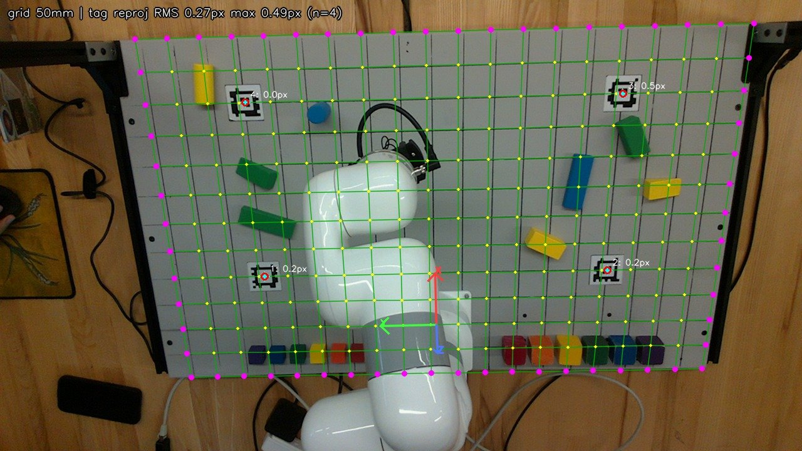
   The board's 50 mm grid (yellow) projected through K and the AprilTag extrinsics. It stays on the printed lines, including in the corners far from the tags.

- **Intrinsics.** We ran three checkerboard calibrations. The run with the board slid flat had the *lowest* reprojection error (0.10 px), yet its focal lengths were 43–52% off, because a flat board cannot separate focal length from distance. The two runs with the board tilted through the volume matched the factory values within 0.7%, so we use the factory K.
- **Extrinsics.** `solvePnP` on four AprilTags. We re-run it every session: the tag RMS stayed at 0.27–0.31 px even when the camera had shifted 28 mm between sessions. A hand-measured matrix (tape measure plus a phone IMU for the tilt) agreed within 1.4° and 43 mm, which is fine as a sanity check but not accurate enough for grasping.
- **Depth–color registration.** The L515's own alignment was off by up to 10 px, most of all at the left edge of the image. We measured the shift on 235 block edges in 11 snapshots, fitted a per-axis offset and scale, and now resample every depth frame.
- **Depth bias.** At calibration time the extrinsics give the true range along every table ray. We fit a quadratic surface to the measured-minus-true range, using a median gate and 3σ clipping to reject blocks and the arm.

## Block detection

  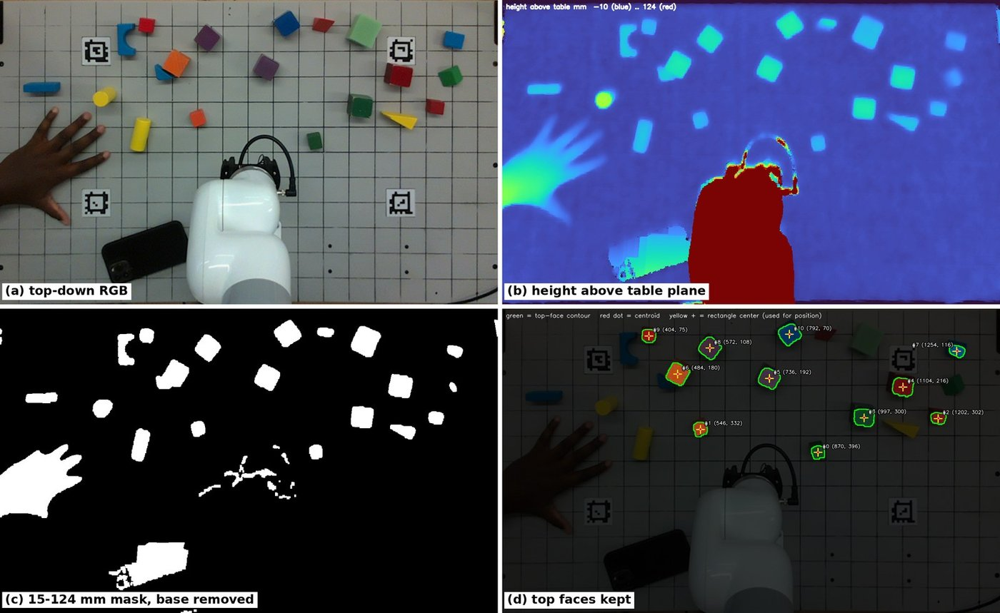
   Detector stages: (a) RGB warped top-down, (b) height above the fitted table plane, (c) pixels 15–124 mm high with the arm base removed, (d) top faces kept for measurement.

The detector warps the registered depth into a top-down view and fits the table plane at the four tags. It then thresholds by height and keeps each region's top face. Color is read last, from the median hue of the eroded top face. Each candidate then has to pass nine rejection tests: area, outline, flat top, level top, ramp ring, shape, size, stack height and single color. Every rejected region is drawn in the GUI with the name of the test it failed, and that is how we tuned the thresholds.

  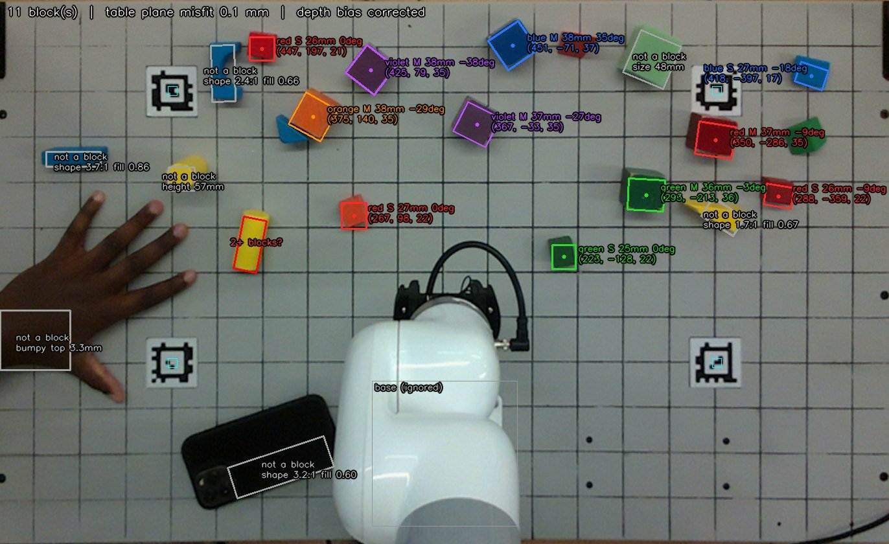
   Distractors are rejected and labeled with the test they failed (hand: flat top; phone, bar, arch, prism: shape; sponge: size; standing cylinder: height).

| Detector result on a 52-block test board | Value |
|---|---|
| Blocks found | 50 / 52, 0 false positives |
| Position error, mean / max | 4.4 / 8.3 mm |
| Color correct (final hue rules) | 49 / 52 |
| Table-plane misfit (RMS) | 0.54 mm |

Before any threshold change, we replayed the detector offline on saved RGB-D snapshots and kept the change only if it lost nothing but single frames of blocks at the board edge. For example, a tighter aspect limit would have lost 16 real blocks, and a 20 mm height floor for dropping thin pieces would have lost 58 real detections. We added the level-top and ramp tests instead. Event run logs record every rejected region and the reason, and they exposed the remaining failures, such as a violet cube past the old blue/violet hue boundary.

<b>More detector figures</b>

  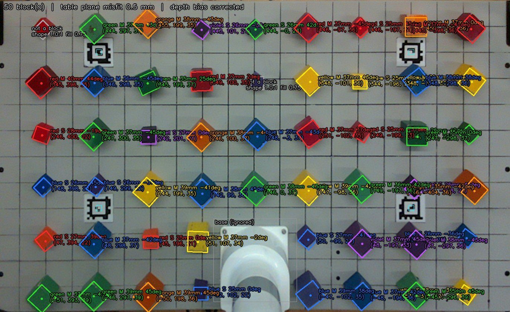 
  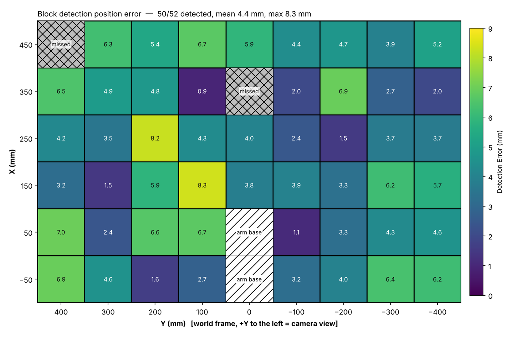
  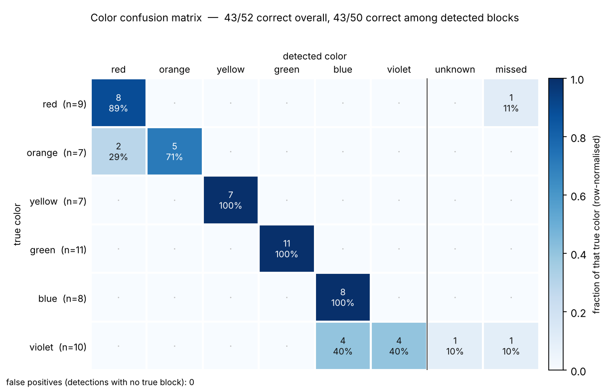 
  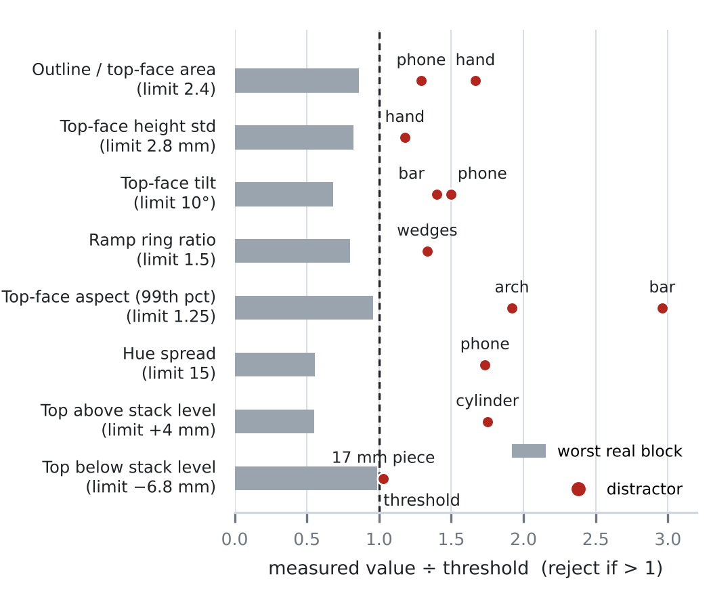

## Videos

**Click-to-grab and click-to-place, real arm.** Clicking a detected block picks it up, and clicking a target places or stacks it. Clicks the arm cannot reach are refused without moving.

https://github.com/user-attachments/assets/5714f4a9-d809-403a-baaa-9f08d2093be0

**Click-to-grab, control-station view.**

https://github.com/user-attachments/assets/55d9aa61-5be3-4df9-b780-e72211fe7a6d

**Extrinsic calibration.** The camera is re-aimed on its bracket, then Calibrate squares the top-down workspace view up again.

https://github.com/user-attachments/assets/933a80d7-ff48-43ea-b697-b50a5978ce19

**Teach-and-repeat.** A 25-waypoint, three-block stack recorded by hand-guiding the arm, then replayed: [YouTube](https://youtube.com/shorts/VigqkL3qs3I).

## Limitations and next steps

- **3D accuracy is the weakest link.** There is about 9 mm of range error along each viewing ray, plus a nearly constant +11 mm offset in x. The offset most likely comes from the hand-measured fixture we used as ground truth. The per-pixel bias correction fixes the heights of clicked points.
- **The gripper cannot sense a grasp.** "Holding" only means the last command was close. Most failures in practice came from the board model rather than from IK, for example a block that slipped and was not seen until the next look.
- **Touching blocks merge** into one region, which is flagged as "2+ blocks?".
- **Next steps:** grasp sensing, frame-to-frame tracking, and calibrating over many tag poses instead of four coplanar tags.

## Report

The full write-up, with the derivations, every table and the appendix figures, is in [`report/armlab_report.pdf`](report/armlab_report.pdf).

## Code

The source code is not public for now because this is a course project. It is available to reviewers on request.

## Team

Hsiang-Yu (Rich) Kung · Papa Yaw Wireko Boampong · Ajinkya Pawar. We split the work roughly equally, and all three of us worked across kinematics, calibration, detection and the event strategy.

Thanks to the ROB 550 course staff for the lab hardware, starter code and MuJoCo bridge.
